# Windows Threat Detection with Splunk

I built a single-endpoint Windows lab to see how discovery commands appear in Sysmon and how to find them in Splunk. I ran five Atomic Red Team tests and captured process telemetry for each. Four tests have a matching event in the cleaned results. T1087.001 has raw event evidence and its clean detection is still unverified.

## Lab setup

`Windows 11 → Sysmon and Windows Event Logs → Splunk Universal Forwarder → Splunk Enterprise`

All components ran on one Windows 11 laptop. Sysmon 15.22 recorded process creation as Event ID 1. The Universal Forwarder sent XML event logs to the local Splunk Enterprise receiver at `127.0.0.1:9997`, into `index=main`. The [sanitized input example](config/inputs.conf.example) shows the four monitored channels and `renderXml = true`.

The source records the receiver and monitored channels. It does not record the original Sysmon installer command or the forwarder output configuration. I checked ingestion in Splunk with this search.

```spl
index=main
| stats count by source sourcetype
```

The repository recorded these counts on 16 November 2026 over a 24-hour search window.

| Source | Events |
| --- | ---: |
| Sysmon Operational | 137,749 |
| Windows Security | 12,570 |
| Windows System | 431 |
| PowerShell Operational | 201 |
| **Total** | **150,951** |

These totals measure log ingestion. With XML rendering enabled, the discovery searches use the literal `<EventID>1</EventID>` in the event instead of relying on an extracted `EventCode` field.

### Atomic Red Team setup

I installed the PowerShell YAML module, extracted the Invoke-AtomicRedTeam ZIP, imported the module and confirmed that PowerShell could find `Invoke-AtomicTest`.

<details>
<summary>PowerShell setup and screenshots</summary>

```powershell
Install-Module -Name powershell-yaml -Scope CurrentUser
Get-Module -ListAvailable powershell-yaml
Test-Path "$HOME\invoke-atomicredteam.zip"
Expand-Archive -Path "$HOME\invoke-atomicredteam.zip" -DestinationPath "$HOME\AtomicFramework" -Force
Get-ChildItem "$HOME\AtomicFramework" -Recurse -Filter "Invoke-AtomicRedTeam.psm1" | Select-Object FullName
Import-Module "$HOME\AtomicFramework\invoke-atomicredteam-master\Invoke-AtomicRedTeam.psm1"
Get-Command Invoke-AtomicTest
Test-Path "C:\AtomicRedTeam\atomics"
```

The default definitions path was absent. I used `Install-AtomicsFolder -InstallPath "$HOME\AtomicFramework" -NoPayloads` after loading the upstream installer. The definitions ended up in `$HOME\AtomicFramework\atomics`. The initial test listing produced a logger error. The documented test invocations used `-NoExecutionLog`.

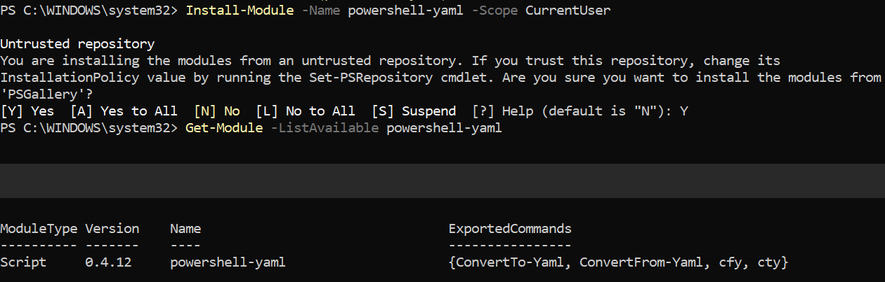

*PowerShell lists powershell-yaml 0.4.12 after installation.*

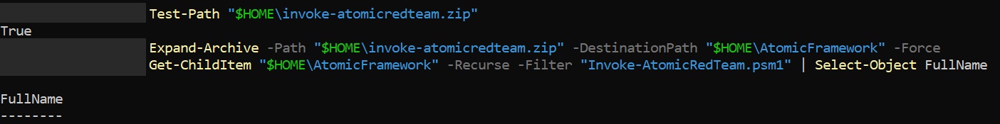

*PowerShell confirms the framework ZIP exists and expands it.*

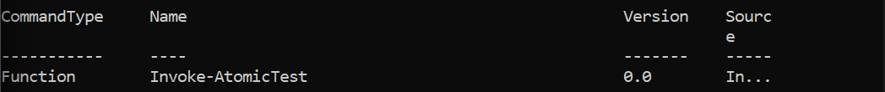

*Get-Command identifies Invoke-AtomicTest as an available function.*

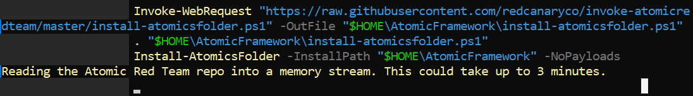

*Install-AtomicsFolder starts downloading the definitions with payloads excluded.*

</details>

## Discovery tests

I compared the executable, arguments, timestamp and parent process in Splunk. The raw searches narrowed the results to Sysmon Event ID 1. The cleaned searches used `rex` on `_raw` to extract `Image`, `CommandLine` and `ParentImage` from the XML.

| MITRE ATT&CK technique | Atomic test | Lab result |
| --- | ---: | --- |
| [T1082](https://attack.mitre.org/techniques/T1082/) System Information Discovery | 7 | `hostname` under `cmd.exe` |
| [T1087.001](https://attack.mitre.org/techniques/T1087/001/) Local Account Discovery | 8 | Raw telemetry captured. Clean detection unverified. |
| [T1033](https://attack.mitre.org/techniques/T1033/) System Owner/User Discovery | 8 | `whoami /all` under `cmd.exe` |
| [T1016](https://attack.mitre.org/techniques/T1016/) System Network Configuration Discovery | 1 | One `ipconfig /all` event under `cmd.exe` |
| [T1057](https://attack.mitre.org/techniques/T1057/) Process Discovery | 2 | One `tasklist` event under `cmd.exe` |

### T1082 · Hostname discovery

Atomic test 7 ran `hostname`. The [SPL](detections/T1082.spl) searches for `hostname.exe` and displays the extracted process fields. The captured window returned five events. The test event at 19:19:40 on 17 November 2026 had `cmd.exe /c hostname` as the parent command. The other rows shown had a PowerShell parent.

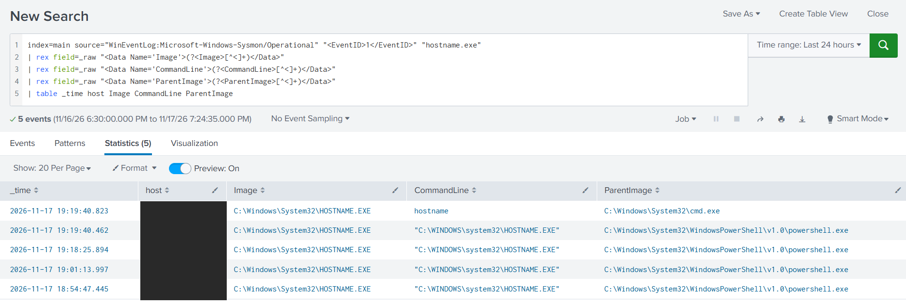

*The hostname results include an Atomic run with cmd.exe as the parent. The other visible rows have a PowerShell parent.*

<details>
<summary>PowerShell and raw search evidence</summary>

```powershell
Invoke-AtomicTest T1082 -TestNumbers 7 -NoExecutionLog -PathToAtomicsFolder "$HOME\AtomicFramework\atomics"
```

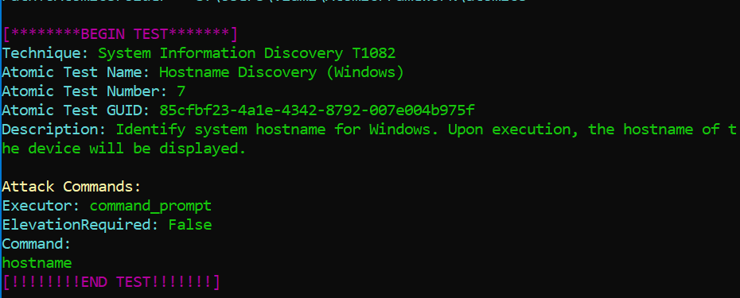

*Atomic test 7 uses the Windows hostname command.*

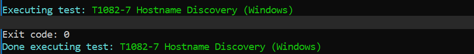

*The hostname test exited with code 0.*

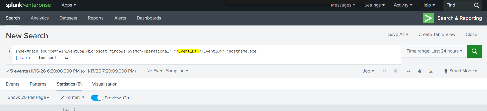

*The raw hostname search returned five Sysmon process events in this window. Raw rows are excluded.*

</details>

### T1087.001 · Local account discovery

The test that ran was **test 8**, “Enumerate all accounts on Windows (Local).” It exited with code 0. The broad raw search included `net.exe`, `net1.exe` and `cmdkey.exe` and returned 11 process events in the captured window. Account, group and stored-credential output was removed from the published evidence.

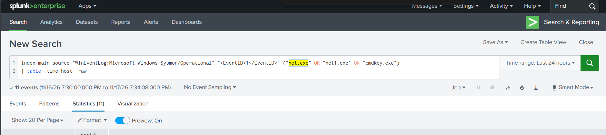

*The broad net.exe, net1.exe and cmdkey.exe search returned 11 Sysmon events. Raw rows are excluded.*

The [candidate SPL](detections/T1087.001.spl) looks for `net.exe` or `net1.exe` with a `user` token in the command line. The test also listed local groups and stored credential targets. The SPL covers the account-enumeration portion and still needs validation against the test event and normal administrative activity. The raw search and chart totals do not validate this filter.

<details>
<summary>Test identification and completion</summary>

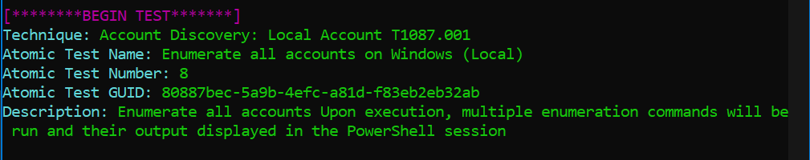

*The test details identify Windows local account enumeration as Atomic test 8. The command section is excluded.*

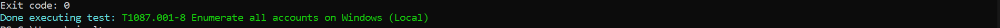

*The local account test exited with code 0. Account, group and credential output is excluded.*

</details>

### T1033 · System owner and user discovery

Atomic test 8 ran `whoami /all`. The [SPL](detections/T1033.spl) filters the extracted image for `whoami.exe`. The raw and cleaned views show 13 matches in the captured window, including a `whoami /all` event with `cmd.exe` as the parent at 12:34:18 on 18 November 2026.

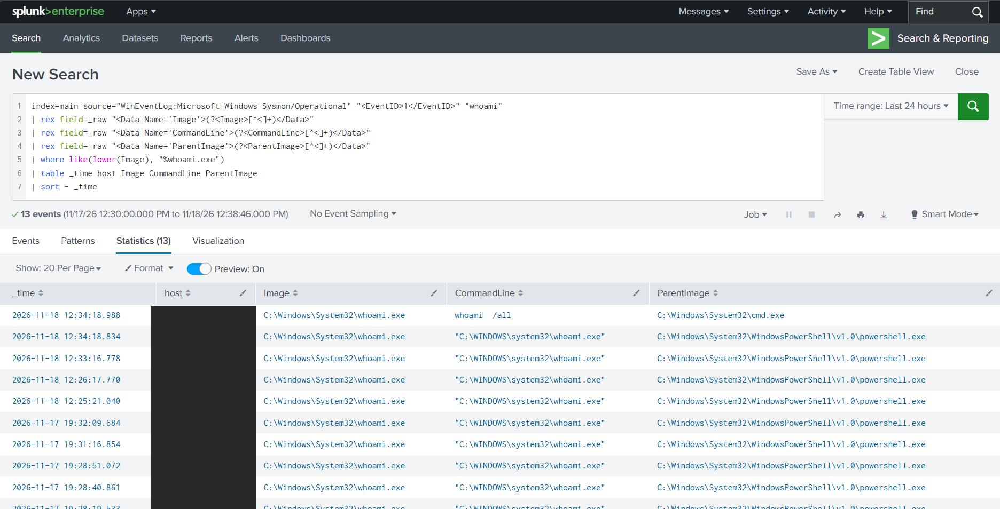

*The clean result includes whoami /all with cmd.exe as the parent.*

<details>
<summary>PowerShell and raw search evidence</summary>

```powershell
Invoke-AtomicTest T1033 -TestNumbers 8 -NoExecutionLog -PathToAtomicsFolder "$HOME\AtomicFramework\atomics"
```

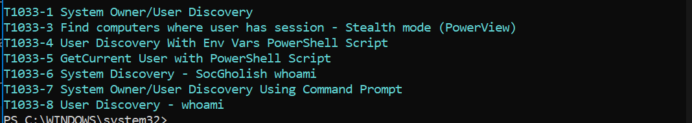

*The list of T1033 tests identifies test 8 as User Discovery using whoami.*

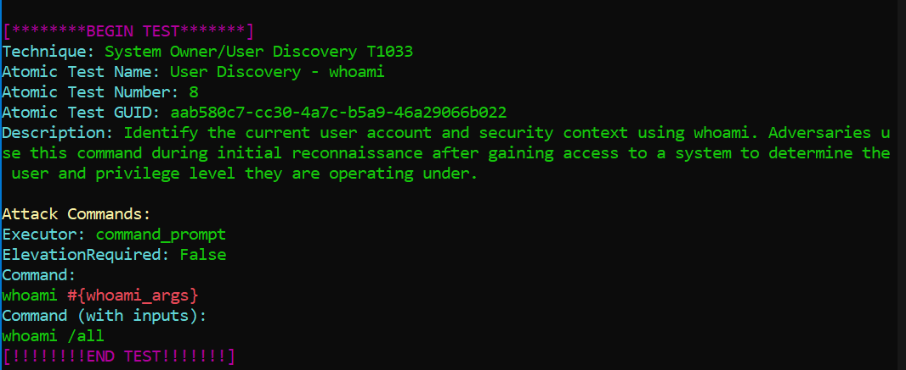

*The test details show whoami /all as the expanded command.*

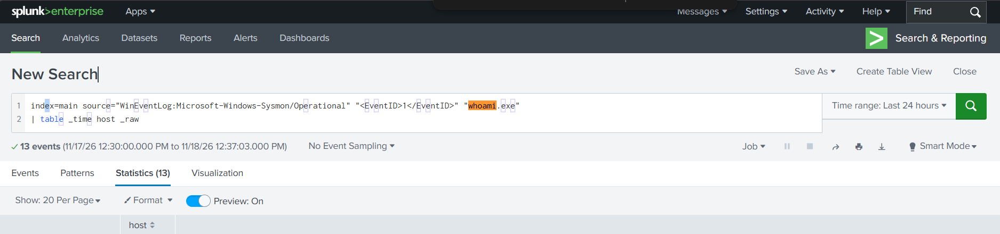

*The raw whoami search returned 13 process events in this window. Raw rows are excluded.*

</details>

### T1016 · Network configuration discovery

Atomic test 1 included `ipconfig /all`, `netsh interface show interface`, `arp -a`, `nbtstat -n` and `net config`. The [SPL](detections/T1016.spl) follows the captured search for the `ipconfig.exe` event. It returned one match at 12:57:14 on 18 November 2026, with `cmd.exe` as the parent.

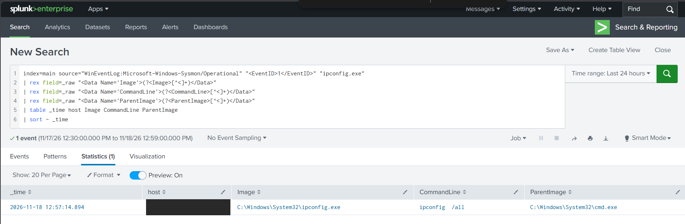

*The extracted fields show ipconfig /all, cmd.exe and the event timestamp.*

<details>
<summary>PowerShell and raw search evidence</summary>

```powershell
Invoke-AtomicTest T1016 -TestNumbers 1 -NoExecutionLog -PathToAtomicsFolder "$HOME\AtomicFramework\atomics"
```

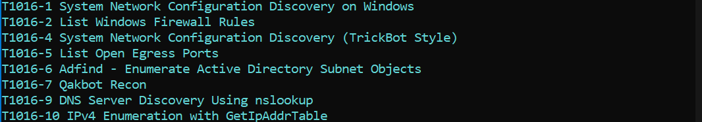

*The T1016 list identifies test 1 as Windows network configuration discovery.*

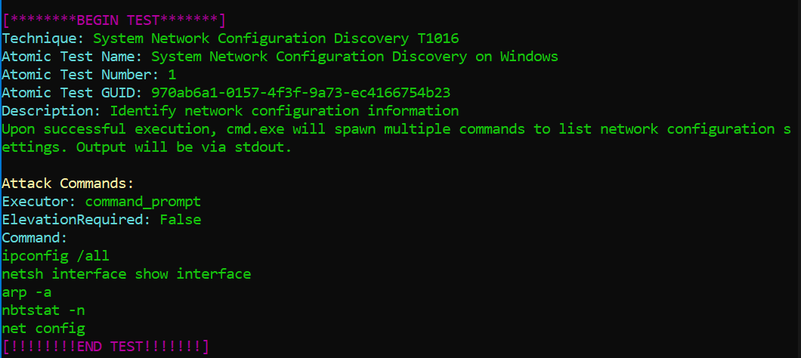

*The Atomic definition includes ipconfig /all and additional local network inventory commands.*

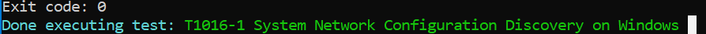

*The network configuration test exited with code 0. Host and adapter output is excluded.*

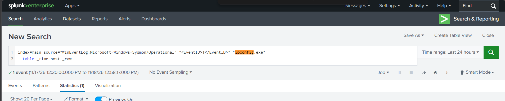

*The raw ipconfig search returned one Sysmon process event. Raw rows are excluded.*

</details>

### T1057 · Process discovery

Atomic test 2 ran `tasklist`. The [SPL](detections/T1057.spl) searches for `tasklist.exe` and displays the process fields. It returned one match at 13:04:53 on 18 November 2026, with `cmd.exe` as the parent.

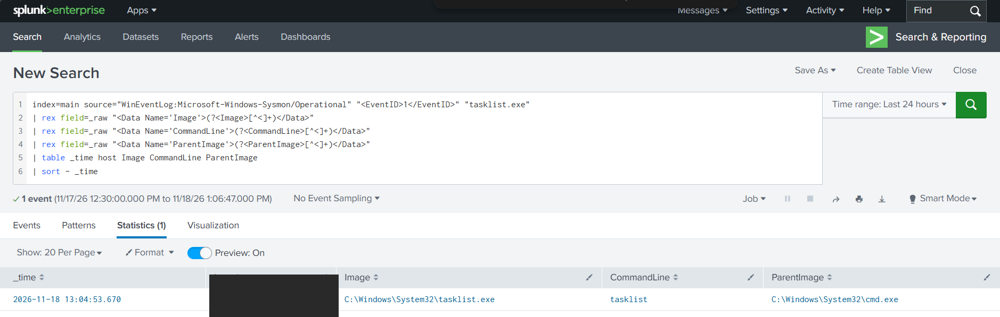

*The extracted fields show one tasklist event with cmd.exe as the parent.*

<details>
<summary>PowerShell and raw search evidence</summary>

```powershell
Invoke-AtomicTest T1057 -TestNumbers 2 -NoExecutionLog -PathToAtomicsFolder "$HOME\AtomicFramework\atomics"
```

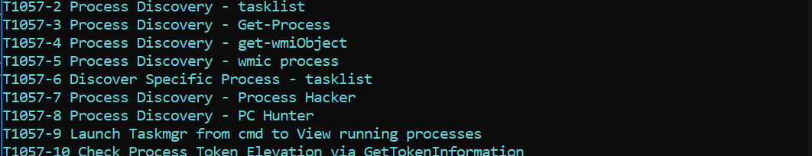

*The T1057 list identifies test 2 as Process Discovery using tasklist.*

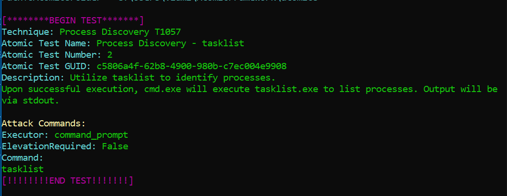

*The test definition shows that cmd.exe launches tasklist.*

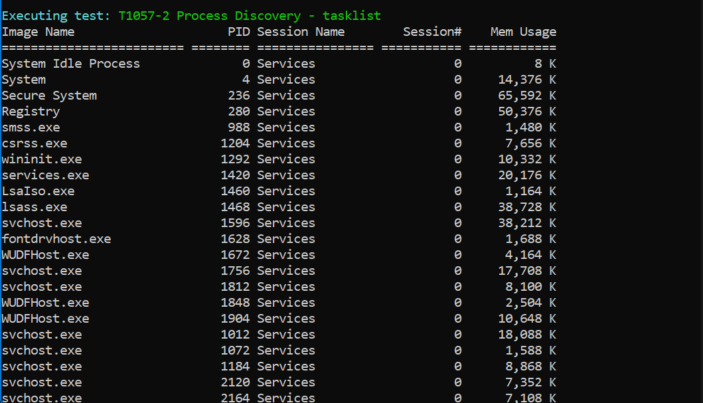

*The Atomic process discovery test printed the running-process table.*

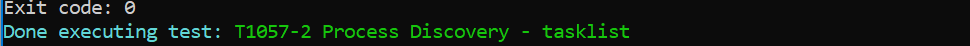

*The process discovery test exited with code 0.*

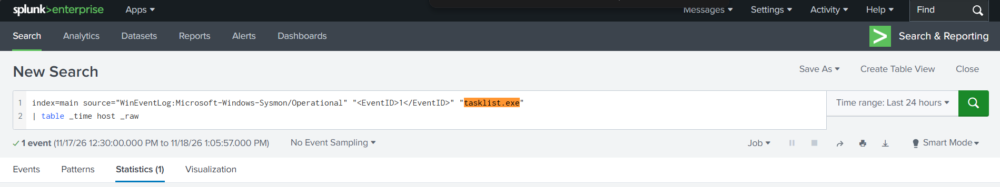

*The raw tasklist search returned one Sysmon process event. Raw rows are excluded.*

</details>

## Splunk reports and dashboard

The **Windows Threat Detection & MITRE ATT&CK Dashboard** brings the five report panels together. The report names are visible in the dashboard capture. Four panels show event rows. The Local Account Discovery panel title is visible at the bottom, with its result outside the capture. The PDF includes dashboard screenshots and does not include an export.

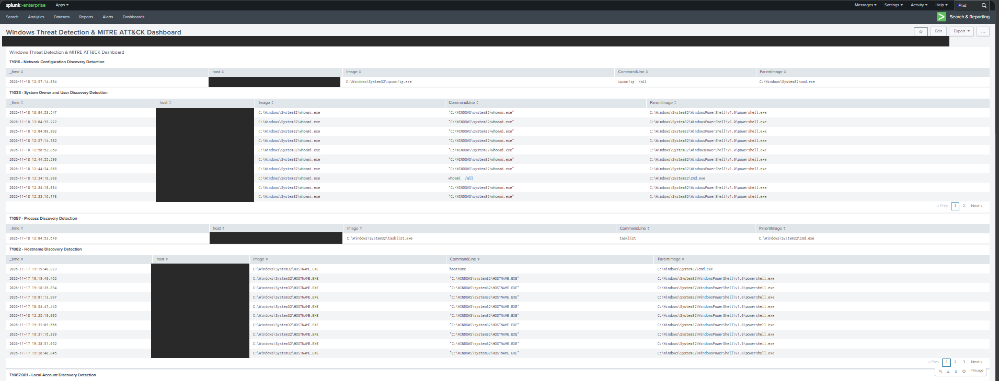

*The dashboard shows report panels for the five techniques. The capture shows the T1087.001 panel title, with no clean-query result visible.*

In Search & Reporting, I grouped Sysmon process events by executable and counted them by technique with `stats count by Technique`. The search returned 55 process matches.

| Bucket | Events |
| --- | ---: |
| T1082 · Host discovery | 22 |
| T1033 · User discovery | 20 |
| T1087.001 · Account discovery | 11 |
| T1016 · Network discovery | 1 |
| T1057 · Process discovery | 1 |

The account bucket groups any extracted image ending in `net.exe`, `net1.exe` or `cmdkey.exe`. It is broader than the candidate detection. Counts depend on the selected time range and include other activity on the laptop.

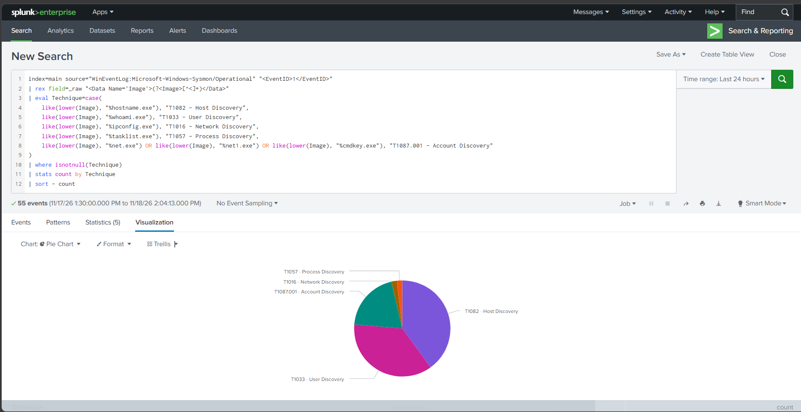

*The aggregation search and pie chart show 55 process matches in five technique buckets.*

<details>
<summary>Technique totals SPL</summary>

```spl
index=main source="WinEventLog:Microsoft-Windows-Sysmon/Operational" "<EventID>1</EventID>"
| rex field=_raw "<Data Name='Image'>(?<Image>[^<]+)</Data>"
| eval Technique=case(
    like(lower(Image), "%hostname.exe"), "T1082 - Host Discovery",
    like(lower(Image), "%whoami.exe"), "T1033 - User Discovery",
    like(lower(Image), "%ipconfig.exe"), "T1016 - Network Discovery",
    like(lower(Image), "%tasklist.exe"), "T1057 - Process Discovery",
    like(lower(Image), "%net.exe") OR like(lower(Image), "%net1.exe") OR like(lower(Image), "%cmdkey.exe"), "T1087.001 - Account Discovery"
  )
| where isnotnull(Technique)
| stats count by Technique
| sort - count
```

</details>

<details>
<summary>Pie detail, bar, area and column views</summary>

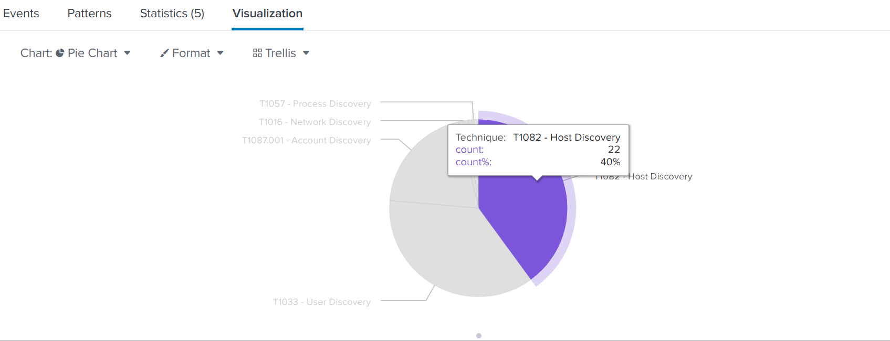

*The pie tooltip shows 22 hostname matches, or 40 percent of the 55 events.*

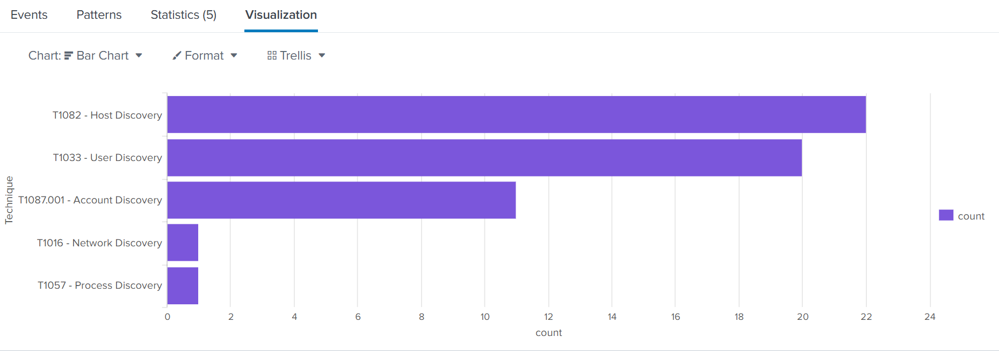

*The horizontal bar chart shows 22, 20, 11, 1 and 1 matches across the five categories.*

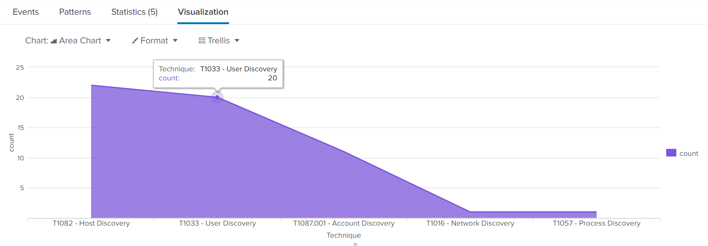

*The area view plots the same category totals on a categorical axis.*

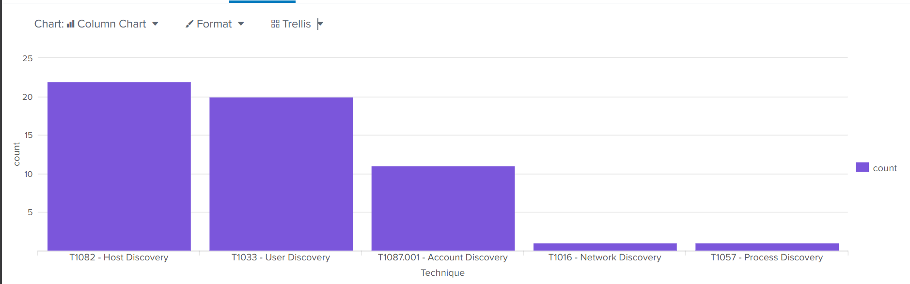

*The column view displays the same counts as vertical bars.*

</details>

## What I learned

- Correlating the command line, parent process and test time helped distinguish each Atomic run from other executions of the same program.
- A raw keyword match can occur elsewhere in an XML event. Checking the extracted image and arguments makes it easier to explain what matched.
- The lab covers one Windows endpoint and five discovery tests. The screenshots show historical search results. Production alert quality and false-positive rates were outside the lab evaluation.

[MIT License](LICENSE)
