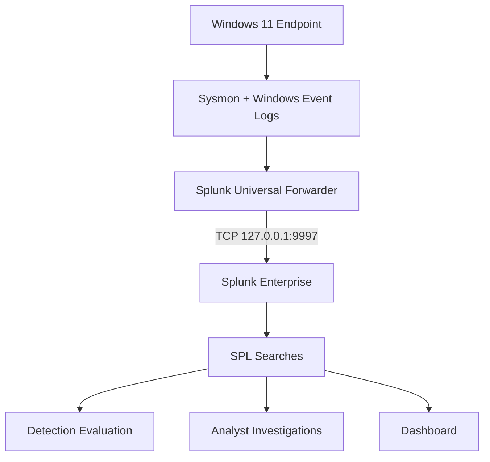

# Endpoint telemetry pipeline

All components currently run on the same Windows laptop. Sysmon, Security, System and PowerShell Operational logs were observed in Splunk on 16 November 2026.

<!-- TODO SCREENSHOT: ../screenshots/01-splunk-ingestion-summary.png — evidence of four indexed event sources. -->
<!-- TODO: Add a sanitized architecture diagram image if desired, without private machine identifiers. -->
